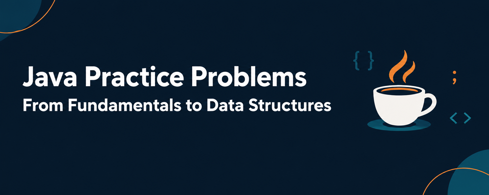
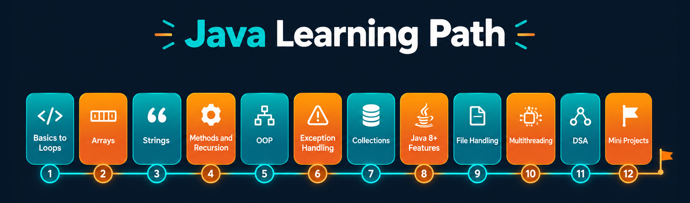

# Java Practice Problems


A structured collection of Java programming problems with solutions, organized by topic from core fundamentals to data structures.

Each topic lives in its own folder with a problem list and the solution programs.

## Contents

- [Topics](#topics)
- [Repository Structure](#repository-structure)
- [Getting Started](#getting-started)
- [Conventions](#conventions)
- [Author](#author)

## Topics



| No. | Topic | Solved | Status |
|-----|-------|--------|--------|
| 01 | [Basics to Loops](./01-basics-to-loops) | 20 / 100 | In progress |
| 02 | Arrays | - | Planned |
| 03 | Strings | - | Planned |
| 04 | Methods and Recursion | - | Planned |
| 05 | Object Oriented Programming | - | Planned |
| 06 | Exception Handling | - | Planned |
| 07 | Collections Framework | - | Planned |
| 08 | Java 8+ Features | - | Planned |
| 09 | File Handling and I/O | - | Planned |
| 10 | Multithreading and Concurrency | - | Planned |
| 11 | Data Structures and Algorithms | - | Planned |
| 12 | Mini Projects | - | Planned |

**01 Basics to Loops** covers output, variables, data types, type conversion, operators, user input, conditional statements, loops, number programs, patterns, and mini programs.

## Repository Structure

```
java-practice-problems/
├── README.md
├── .gitignore
├── assets/
│   ├── banner.png
│   └── roadmap.png
├── 01-basics-to-loops/
│   ├── README.md
│   ├── Q001_HelloJava.java
│   ├── Q002_IntroduceYourself.java
│   └── ...
├── 02-arrays/
├── 03-strings/
└── ...
```

Each topic folder contains a `README.md` with the problem list and one `.java` file per problem.

## Getting Started

**Prerequisites**

- JDK 17 or later
- Git

**Clone the repository**

```bash
git clone https://github.com/peeyoosh-k/java-practice-problems.git
cd java-practice-problems
```

**Compile and run a program**

```bash
cd 01-basics-to-loops
javac Q001_HelloJava.java
java Q001_HelloJava
```

## Conventions

- One problem per file, named `QXXX_ProblemName.java` (for example `Q001_HelloJava.java`).
- The file name and the public class name are always identical.
- Class names use `PascalCase`; methods and variables use `camelCase`.
- Each file starts with a comment stating the problem and ends with a comment showing the expected output.
- Programs are compiled and tested before being committed.

## Author

[@peeyoosh-k](https://github.com/peeyoosh-k)